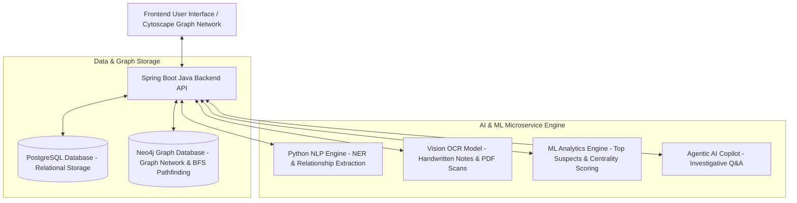

# 🛡️ Drishti — Criminal Network Intelligence Platform
## Complete System Architecture & AI Context Specification

> **Note for AI Agents**: This document provides the complete technical context, data schemas, API specifications, and architectural workflows for the **Drishti Intelligence Platform**. Use this to understand all entities, services, endpoints, and intelligence features.

---

## 📍 1. System Mission & Overview

**Drishti** is an AI-powered Law Enforcement and Forensic Intelligence Platform built to analyze, visualize, and dismantle complex criminal syndicates, Hawala money laundering networks, narcotics rings, and organized crime operations.

### Key Capabilities:
1. **Interactive Knowledge Graph Network**: Visualizes multi-hop connections between suspects, phone numbers, bank accounts, vehicles, and safehouse locations using Cytoscape.js and Neo4j.
2. **Top Suspect & Key Actor Identification**: Leverages graph centrality algorithms (PageRank, Betweenness Centrality, Degree Centrality) to automatically identify syndicate kingpins and high-risk operatives.
3. **Vision OCR & Multilingual Handwritten Evidence Processing**: Transcribes handwritten case notes, diaries, and court bail judgments (including Gurmukhi/Punjabi scripts) into structured forensic entity JSON.
4. **Automated NLP Entity & Relationship Extraction**: Automatically extracts entities (`PERSON`, `ORGANIZATION`, `COURT`, `PHONE`, `BANK_ACCOUNT`, `VEHICLE`) and relationship edges (`MANAGES`, `TRANSFERRED_TO`, `USES_PHONE`, `ASSOCIATED_WITH`).
5. **Hawala & Financial Flow Tracking**: Tracks layered wire transfers between shell company accounts and matches them against cash couriers.
6. **Call Detail Records (CDR) & Surveillance Analysis**: Analyzes phone call frequency/duration patterns and correlates field agent surveillance logs with vehicle location tracking.
7. **Agentic AI Copilot**: A conversational AI assistant that queries backend services to answer complex investigative questions in natural language.

---

## 🏗️ 2. High-Level Architecture & Component Stack

### Technology Stack:
- **Backend Core**: Java 21, Spring Boot 3, Spring Data JPA, Spring Data Neo4j.
- **Relational Storage**: PostgreSQL (Render Hosted / Local).
- **Graph Database**: Neo4j (Cypher queries, real-time node & edge synchronization).
- **AI/ML Engine**: Python, OpenRouter Vision Models (GPT-4o-mini / Claude), SpaCy / Transformers for NER, NetworkX for graph centrality.
- **Frontend Visualization**: React, Cytoscape.js, KaTeX, Tailwind/Vanilla CSS.

---

## 🎯 3. Core Feature Breakdown

### A. Top Suspect & Key Actor Ranking
- **Algorithm**: Runs PageRank, Betweenness Centrality, and Degree Centrality over the Neo4j/JPA network graph.
- **Goal**: Identifies hidden syndicate leaders who may not be directly listed in FIRs but command high influence over financial and call networks.
- **API Response**: Returns `entityId`, `centralityScore` (0.0 to 1.0), and assigned `role` (`KINGPIN`, `HAWALA_OPERATOR`, `FINANCIER`, `FRONT_DIRECTOR`).

### B. Vision OCR & Handwritten Document Processing
- Transcribes handwritten paper notes, physical angadia ledgers, and court bail PDFs.
- Passes transcribed text to SpaCy/LLM NLP pipeline.
- Automatically creates `DocumentEntity`, saves entities to `persons`, `phones`, `accounts`, `vehicles`, and creates `relationships` edges in Postgres & Neo4j.

### C. Smart Entity Resolution & Deduplication
- Automatically normalizes extracted person names (case-insensitive).
- Merges repeat mentions across multiple documents (e.g. `Sameer Khan` in DOC045 and DOC046) into a single master person ID (`P-101` or `P-119`).
- Eliminates raw span ID clutter (`DOC045:e178_189`) in favor of clean IDs (`P-XXX`).

### D. Multi-Hop Shortest Pathfinding
- Computes BFS (Breadth-First Search) shortest paths between any two suspects or bank accounts to uncover hidden intermediary money mules or phone couriers.

---

## 🗄️ 4. Data Schemas & Database Entities

### 1. `investigation_cases` (`CaseEntity`)
- `caseId` (PK, varchar(32)): e.g., `CASE-HAWALA-2026`
- `title` (varchar): Case title
- `description` (text): Case summary or raw forensic text
- `status` (varchar): `ACTIVE`, `CLOSED`, `UNDER_REVIEW`

### 2. `persons` (`PersonEntity`)
- `personId` (PK, varchar(32)): e.g., `P-101`
- `name` (varchar): Full name
- `aliases` (list): Known alias strings
- `age` (integer), `dateOfBirth` (date), `address` (text)
- `status` (varchar): `KINGPIN`, `HAWALA_OPERATOR`, `PRIMARY_SUSPECT`, `EXTRACTED_PERSON`
- `notes` (text)

### 3. `phones` (`PhoneEntity`)
- `phoneId` (PK, varchar(32)): e.g., `PH-901`
- `phoneNumber` (varchar, unique): e.g., `+91-9876543210`
- `ownerPersonId` (varchar): Foreign key to `persons.person_id`
- `status` (varchar): `ACTIVE`, `INACTIVE`, `BURNER`

### 4. `accounts` (`AccountEntity`)
- `accountId` (PK, varchar(32)): e.g., `ACC-9901`
- `accountNumber` (varchar, unique): e.g., `918020048811`
- `accountType` (varchar): `CURRENT`, `SAVINGS`, `OFFSHORE`, `ESCROW`
- `ownerPersonId` (varchar): Foreign key to `persons.person_id`
- `institution` (varchar): Bank name (e.g., `HDFC Bank`)

### 5. `vehicles` (`VehicleEntity`)
- `vehicleId` (PK, varchar(32)): e.g., `VEH-101`
- `registrationNumber` (varchar, unique): e.g., `MH-01-EQ-9999`
- `make` (varchar), `model` (varchar)
- `ownerPersonId` (varchar): Foreign key to `persons.person_id`

### 6. `locations` (`LocationEntity`)
- `locationId` (PK, varchar(32)): e.g., `LOC-MUM-01`
- `name` (varchar), `address` (text)
- `latitude` (double), `longitude` (double)

### 7. `documents` (`DocumentEntity`)
- `documentId` (PK, varchar(32)): e.g., `DOC-001`
- `caseId` (varchar): Foreign key to `investigation_cases.case_id`
- `documentType` (varchar): `HANDWRITTEN_NOTE`, `FIR`, `BAIL_JUDGMENT`, `INTELLIGENCE_REPORT`
- `title` (varchar), `text` (text), `source` (varchar), `language` (varchar)
- `nlpResultJson` (text/json): Complete raw NLP output JSON

### 8. `relationships` (`RelationshipEntity`)
- `relationshipId` (PK, varchar(32)): e.g., `REL-001`
- `caseId` (varchar): Case reference
- `sourceId` (varchar): Origin entity ID
- `targetId` (varchar): Destination entity ID
- `relationship` (varchar): `MANAGES`, `TRANSFERRED_TO`, `USES`, `OWNS`, `ASSOCIATED_WITH`
- `confidence` (double): Score 0.0 to 1.0
- `supportText` (text): Evidence snippet

### 9. `transactions` (`TransactionEntity`)
- `transactionId` (PK, varchar(32)): e.g., `TX-5001`
- `sourceAccountId` (varchar), `destinationAccountId` (varchar)
- `amount` (decimal), `currency` (varchar), `timestamp` (timestamp), `description` (text)

### 10. `cdr_records` (`CdrEntity`)
- `cdrId` (PK, varchar(32)): e.g., `CDR-8001`
- `callerPhoneId` (varchar), `receiverPhoneId` (varchar)
- `timestamp` (timestamp), `durationSeconds` (integer)

---

## 🌐 5. Primary REST API Reference

| Method | Endpoint | Description |
| :--- | :--- | :--- |
| `POST` | `/api/cases` | Creates a new case and **auto-ingests forensic entities** into domain tables & graph |
| `GET` | `/api/cases` | Lists all active investigation cases |
| `GET` | `/api/cases/{caseId}` | Retrieves specific case details |
| `GET` | `/api/cases/{caseId}/persons` | Retrieves all persons involved in a specific case |
| `GET` | `/api/cases/{caseId}/fir` | Retrieves legal FIR & judgment documents for a case |
| `GET` | `/api/cases/{caseId}/timeline` | Retrieves full chronological timeline of events & documents |
| `GET` | `/api/persons` | Lists all persons in database |
| `GET` | `/api/persons/search?query={q}` | Searches persons by name or alias |
| `GET` | `/api/persons/{personId}` | Gets single person details |
| `GET` | `/api/persons/{personId}/profile` | Deep profile with owned phones, vehicles, accounts & connections |
| `GET` | `/api/persons/{personId}/connections` | Returns all direct relationship edges |
| `GET` | `/api/persons/{personId}/calls` | Returns call logs (CDRs) for this person's phones |
| `GET` | `/api/persons/{personId}/transactions` | Returns bank transactions for this person's accounts |
| `GET` | `/api/documents` | Lists all uploaded documents |
| `POST` | `/api/cases/{caseId}/documents/upload` | Multipart upload for PDF/image document processing |
| `GET` | `/api/network/entity/{entityId}` | Returns BFS network graph for Cytoscape UI |
| `GET` | `/api/network/cytoscape/{entityId}` | Returns Cytoscape JSON payload (nodes + edges) |
| `GET` | `/api/network/path?source={s}&target={t}` | Calculates shortest path between two entities |
| `GET` | `/api/ml/key-actors` | **Returns Top Suspects ranked by centrality scoring** |
| `GET` | `/api/ml/anomalies` | Returns detected network financial/call anomalies |
| `GET` | `/api/ml/communities` | Returns Louvain sub-syndicate community clusters |

---

## 🤖 6. AI Agent Integration Protocol

When an AI Agent processes new evidence or answers user queries:

1. **When Syncing Document/Case Data**:
   - Make a `POST` request to `/api/cases` with `caseId`, `title`, and `description` (including `[FORENSIC ENTITIES]`).
   - The Spring Boot backend automatically parses and creates the `DocumentEntity`, `PersonEntity` records, `PhoneEntity` records, `AccountEntity` records, `VehicleEntity` records, and `RelationshipEntity` edges in PostgreSQL & Neo4j.

2. **When Answering User Questions**:
   - Use `/api/persons/search` or `/api/persons/{id}/profile` to retrieve entity facts.
   - Use `/api/network/path` to explain connections between two suspects.
   - Use `/api/ml/key-actors` to answer *"Who are the top suspects / kingpins in this syndicate?"*.
